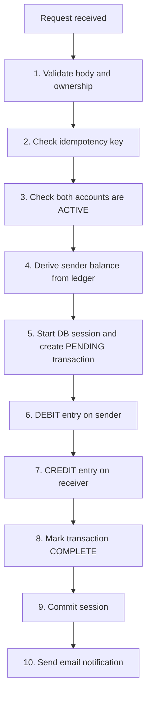

# 🏦 Bank Backend System

A secure RESTful banking backend built with **Node.js, Express and MongoDB**. It supports user authentication, multiple accounts per user, and money transfers recorded in a **double-entry ledger**, with **idempotent** and **atomic** transactions and email notifications.


## ✨ Features

- **Authentication**: register and login with JWT (sent via cookie or `Authorization: Bearer` header) and bcrypt-hashed passwords.
- **Accounts**: a user can own multiple accounts (status, currency) and list them.
- **Double-entry ledger**: every transfer creates a `DEBIT` entry on the sender and a `CREDIT` entry on the receiver. Ledger entries are immutable.
- **Derived balance**: balance is never stored. It is calculated from the ledger (`total credits − total debits`), so it can't drift out of sync.
- **Atomic transfers**: debit, credit and transaction status are written inside a single MongoDB session, so either everything succeeds or nothing is saved.
- **Idempotency**: each transaction carries a unique `idempotencyKey`, so a retried request can never move money twice.
- **Ownership checks**: a user can only send money from, and view the balance of, their own accounts.
- **System user**: a privileged user that funds new accounts through a protected "initial funds" route.
- **Email notifications**: transaction emails via Nodemailer (Gmail OAuth2). A failed email never rolls back a committed transaction.

## 🧰 Tech Stack

| Layer | Technology |
|---|---|
| Runtime | Node.js |
| Framework | Express 5 |
| Database | MongoDB with Mongoose |
| Auth | JSON Web Tokens, bcrypt, cookie-parser |
| Email | Nodemailer (Gmail OAuth2) |
| Config | dotenv |

## 📁 Project Structure

```
Bank Backend System/
├── server.js                      # Entry point: loads env, connects DB, starts server
├── makeSystemUser.js              # One-time script to promote a user to system user
└── src/
    ├── app.js                     # Express app, middleware and route mounting
    ├── config/
    │   └── db.js                  # MongoDB connection
    ├── controller/
    │   ├── auth.controller.js
    │   ├── account.controller.js
    │   └── transaction.controller.js
    ├── middleware/
    │   └── auth.middleware.js     # authMiddleware, authSystemMiddleware
    ├── models/
    │   ├── user.model.js
    │   ├── account.model.js       # includes getBalance()
    │   ├── transaction.model.js
    │   └── ledger.model.js
    ├── routes/
    │   ├── auth.routes.js
    │   ├── account.routes.js
    │   └── transaction.routes.js
    └── services/
        └── email.service.js
```

## 🚀 Getting Started

### Prerequisites

- Node.js 18 or newer
- A MongoDB database that supports transactions (**MongoDB Atlas** or a local replica set)
- A Gmail account with OAuth2 credentials (optional, only needed for email notifications)

### Installation

```bash
git clone https://github.com/prachigupta885/<BankCore>.git
cd <BankCore>
npm install
```

### Environment variables

Copy `.env.example` to `.env` and fill in your values:

```env
MONGO_URI=mongodb+srv://<username>:<password>@<cluster-url>/Bank-System
JWT_SECRET=<a-long-random-string>

# Gmail OAuth2 (for transaction emails)
EMAIL_USER=<your-gmail-address>
CLIENT_ID=<google-oauth-client-id>
CLIENT_SECRET=<google-oauth-client-secret>
REFRESH_TOKEN=<google-oauth-refresh-token>
```

> ⚠️ Never commit your `.env` file. It is already listed in `.gitignore`.

### Run

```bash
npm run dev
```

The server starts on **http://localhost:3000**.

## 📡 API Reference

Base URL: `http://localhost:3000/api`

Protected routes need a JWT, sent either as the `token` cookie (set automatically on login) or as a header:
`Authorization: Bearer <token>`

### Auth

| Method | Endpoint | Description | Auth |
|---|---|---|---|
| POST | `/auth/register` | Register a new user | No |
| POST | `/auth/login` | Login and receive a JWT | No |

### Accounts

| Method | Endpoint | Description | Auth |
|---|---|---|---|
| POST | `/accounts` | Create an account for the logged-in user | User |
| GET | `/accounts` | List the logged-in user's accounts | User |
| GET | `/accounts/balance/:accountId` | Get the balance of one of your accounts | User |

### Transactions

| Method | Endpoint | Description | Auth |
|---|---|---|---|
| POST | `/transaction` | Transfer money between two accounts | User |
| POST | `/transaction/system/initial-funds` | Fund an account from the system account | System user |

### Example requests

**Register**
```http
POST /api/auth/register
Content-Type: application/json

{
  "name": "Prachi",
  "email": "prachi@example.com",
  "password": "secret123"
}
```

**Login**
```http
POST /api/auth/login
Content-Type: application/json

{
  "email": "prachi@example.com",
  "password": "secret123"
}
```

**Transfer money** (sender must be the logged-in user)
```http
POST /api/transaction
Authorization: Bearer <token>
Content-Type: application/json

{
  "fromAccount": "<sender account id>",
  "toAccount": "<receiver account id>",
  "amount": 100,
  "idempotencyKey": "a-unique-key-per-transfer"
}
```

**Get balance**
```http
GET /api/accounts/balance/<accountId>
Authorization: Bearer <token>
```
```json
{
  "accountId": "<accountId>",
  "balance": 900
}
```

## 🔄 How a Transfer Works



If any step between 5 and 9 fails, the whole session is aborted and no money moves.

## 🧑‍💼 Setting Up the System User

The system user is the "bank" that funds new accounts. The `systemUser` flag is `immutable` and cannot be changed through the API, so it is set once directly in the database.

1. Register a user, for example `system@example.com`.
2. Open `makeSystemUser.js` and set that email.
3. Run it once:
   ```bash
   node makeSystemUser.js
   ```
4. Log in as that user and create its account with `POST /api/accounts`.
5. Use that user's token to call `POST /api/transaction/system/initial-funds` with the receiving account, an amount, and a new `idempotencyKey`.

The system account is the source of funds, so its balance goes negative as it funds other accounts. This is expected.

## 🛡️ Design Decisions

- **Ledger over stored balances**: balances come from immutable ledger entries, which gives a full audit trail.
- **Sender comes from the token**: the sender account must belong to the authenticated user, so nobody can spend from someone else's account.
- **Idempotency keys**: a unique index on `idempotencyKey` makes retries safe.
- **Sensitive fields hidden by default**: `password` and `systemUser` use `select: false`.
- **Email is best-effort**: it runs after the commit, in its own `try/catch`.

## 🗺️ Roadmap

- [ ] Input validation with a schema library
- [ ] Rate limiting and security headers (helmet)
- [ ] Transaction history endpoint
- [ ] Automated tests (Jest and Supertest)
- [ ] API documentation with Swagger
- [ ] Docker setup

## 👩‍💻 Author

**Prachi Gupta**

- GitHub: [@prachigupta885](https://github.com/prachigupta885)
- LinkedIn: [Prachi Gupta](https://www.linkedin.com/in/prachi-gupta-pg)

## 📄 License

This project is licensed under the ISC License.
